# APEXLedger User Guide

**Secure client portal for Ntuli Accountants & Associates**

This guide explains how to use the APEXLedger Android app. Find your role in the contents and read that section. Everyone should read **1. Getting started** first.

## Contents

1. [Getting started](#1-getting-started)
2. [Client guide](#2-client-guide)
3. [Accountant guide](#3-accountant-guide)
4. [Manager guide](#4-manager-guide)
5. [Administrator guide](#5-administrator-guide)
6. [Settings for everyone](#6-settings-for-everyone)
7. [Frequently asked questions](#7-frequently-asked-questions)
8. [Troubleshooting](#8-troubleshooting)
9. [Glossary](#9-glossary)

---

## 1. Getting started

### 1.1 Who uses APEXLedger

| Role | What they do |
|---|---|
| **Client** | Requests services, uploads documents, messages their accountant |
| **Accountant** | Handles one service (for example Payroll): reviews documents, updates tickets, messages clients |
| **Manager** | Reviews work and reads management reports |
| **Administrator** | Manages users and settings, can message everyone, sees the audit log |

### 1.2 Signing in

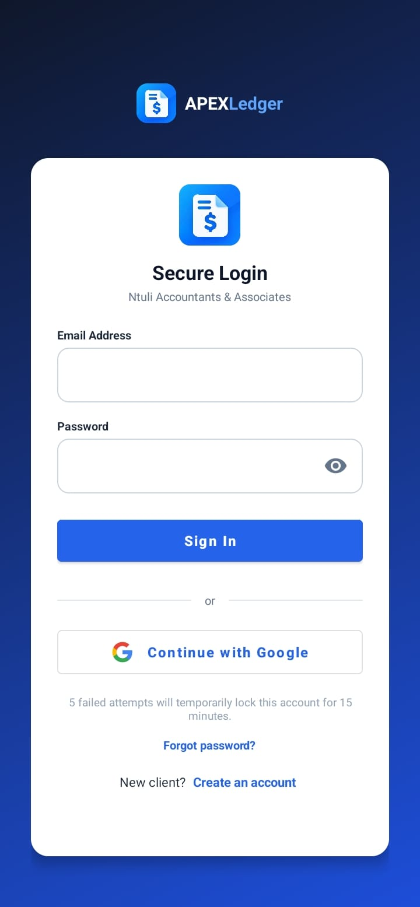
*Figure 1: Login screen*

| Element | What it does |
|---|---|
| **Email Address** | Type the email you registered with |
| **Password** | Type your password. Tap the **eye** icon to show or hide it |
| **Sign In** | Signs you in |
| **Continue with Google** | Signs you in with a Google account on your phone |
| **Forgot password?** | Sends a password reset email to the address you typed |
| **New client? Create an account** | Opens the registration form |

**Good to know**
- After **5 wrong passwords** the account is locked on that phone for **15 minutes**.
- Staff accounts are created by an administrator. You cannot register as staff.
- A **deactivated** account cannot sign in. Contact an administrator.

### 1.3 Creating a client account

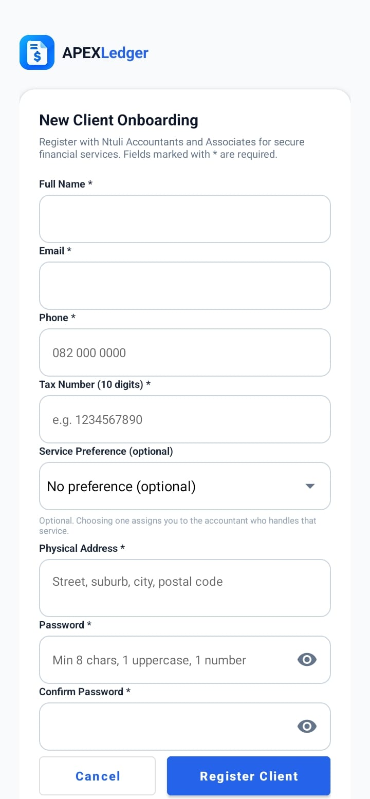
*Figure 2: Registration form*

1. On the login screen tap **Create an account**.
2. Fill in **Full Name, Email, Phone, Tax Number** (exactly 10 digits), **Service Preference**, **Physical Address**, **Password** and **Confirm Password**.
3. The password needs **at least 8 characters, 1 uppercase letter and 1 number**.
4. Tap **Register Client**. Tap **Cancel** to go back.
5. Sign in with your new details.

**Using Google instead:** tap **Continue with Google**. If this is your first time, the form opens as **Complete your profile**. Your name and email are filled in, there is no password, and you tap **Finish**.

### 1.4 Finding your way around

The top bar has a **menu button (three lines)** on the left. Tap it, or swipe from the left edge, to open the **sidebar**. The sidebar lists every screen for your role, and **Logout** at the bottom in red.

---

## 2. Client guide

### 2.1 Your dashboard

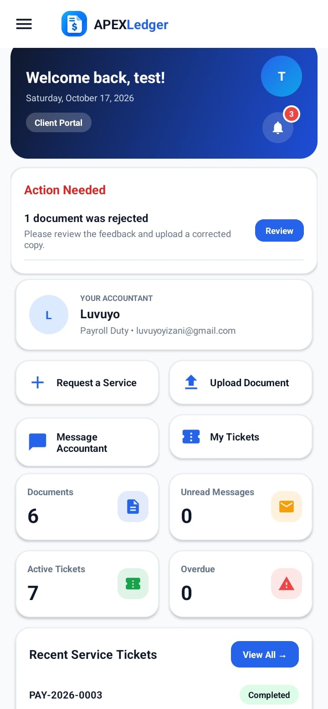
*Figure 3: Client dashboard*

| Element | Meaning |
|---|---|
| **Welcome banner** | Your name, today's date and your portal |
| **Bell** (with red number) | Number of unread notifications. Tap it to open them |
| **Round initials** | Your profile picture placeholder |
| **Your Accountant** | The accountant assigned to you, their duty and email |
| **Request a Service** | Opens the new service request form |
| **Upload Document** | Opens the Documents screen |
| **Message Accountant** | Opens Messages |
| **My Tickets** | Opens your service tickets |
| **Four number cards** | Documents, Unread Messages, Active Tickets, Overdue |
| **Action Needed** (red title) | Something you must do, for example upload documents. It disappears when you have done it |
| **Coming Up** | Your next due dates |
| **Upcoming Public Holidays** | Holidays in the next 45 days, so you can plan around them |
| **Recent Service Tickets** | Your newest tickets. Tap **View All →** for the full list |

**Pull down** on any screen to refresh it.

### 2.2 Requesting a service

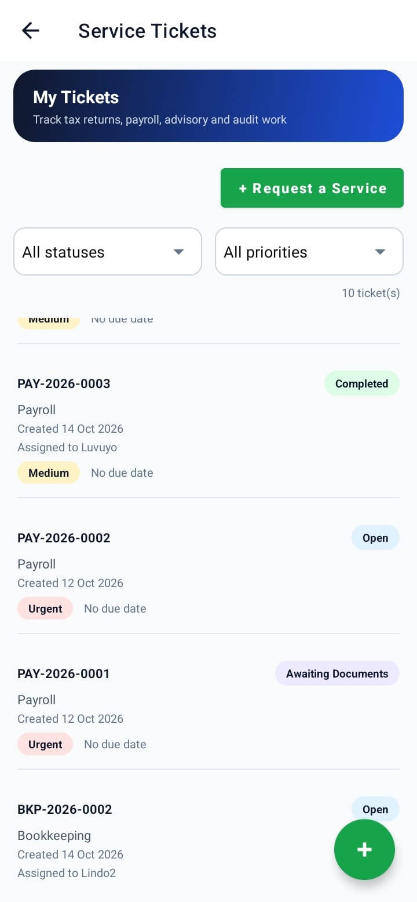
*Figure 4: Service Tickets*

1. Open **Service Tickets** from the sidebar, or tap **Request a Service**.
2. Choose the **Service Type** (Tax Return, Payroll, Bookkeeping, Advisory or Audit).
3. Choose the **Priority** (Low, Medium, High or Urgent).
4. Describe what you need and tap **Create**.
5. Your ticket gets a number such as **TAX-2026-0001**, and the date it was **created** is shown on it.

**Reading a ticket:** each row shows the ticket number, a coloured **status** badge, the service, the **Created** date, the **priority** and the **due date**. A red chip means it is overdue.

| Status | Meaning |
|---|---|
| Open | Received, not started |
| In Progress | Your accountant is working on it |
| Awaiting Documents | Your accountant needs documents from you |
| Under Review | Documents are being checked |
| Completed | Finished |
| Cancelled | Stopped |

Use the two dropdowns at the top (**All statuses**, **All priorities**) to filter the list.

**Who handles my ticket?** It goes to the accountant who handles that service, not always your own accountant. For example, a Payroll request goes to the Payroll accountant.

### 2.3 Uploading and opening documents

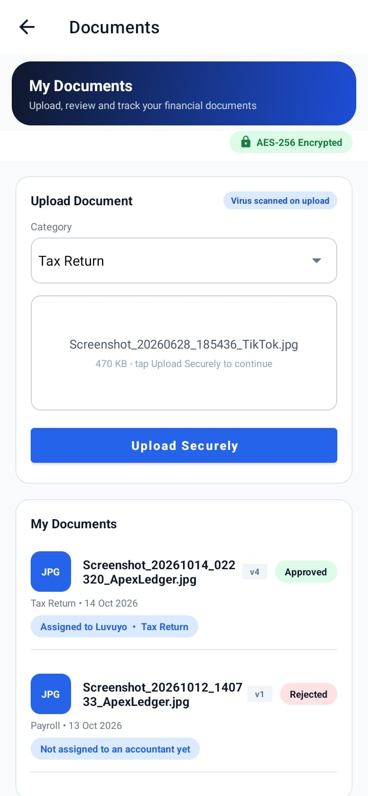
*Figure 5: Documents*

**To upload**
1. Open **Documents**.
2. Choose a **Category** from the dropdown.
3. Tap the box **Tap to upload a file** and pick a **PDF, JPG or PNG** (up to **10 MB**). The box then shows the file name and size.
4. Tap **Upload Securely**. The button shows progress, for example "Uploading 40%".
5. A green message confirms it and names the accountant it was **assigned to**.

> Tip: pick the file from **Downloads** or **Internal storage**. Files that exist only in the cloud (Google Drive, Photos) may not open. Open them once so they download first.

**In My Documents** each file shows a coloured file-type tile, its status (**Pending, Under Review, Approved, Rejected**), the date, the version, and a blue label such as **Assigned to Priya Pillay • Payroll**.

**To open or save a document:** tap it. On the document screen:
- **Open document** opens it in your phone's PDF viewer or gallery.
- **Save to Downloads** saves a copy in *Downloads → APEXLedger*.

**Re-uploading:** upload a corrected file in the same category and it becomes the new version. If a document was **Rejected**, the **Action Needed** card on your dashboard disappears after you upload the corrected copy.

### 2.4 Messaging your accountant

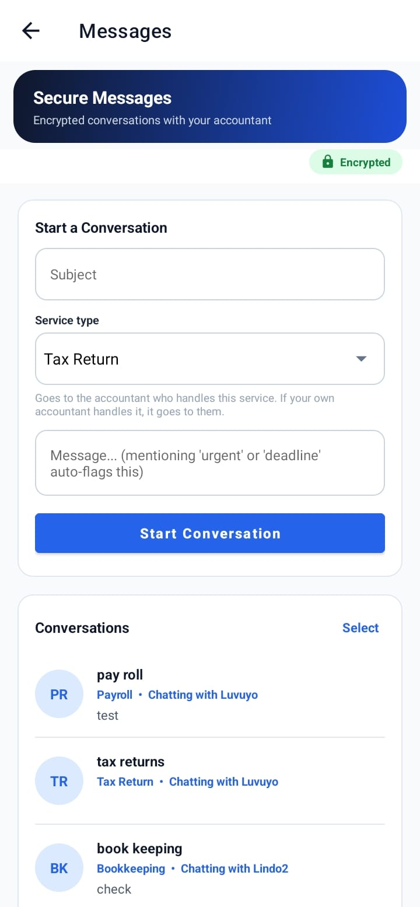
*Figure 6: Messages*

1. Open **Messages**.
2. Under **Start a Conversation** type a **Subject** and your message. Words like *urgent* or *deadline* automatically flag the message as **Urgent**.
3. Tap **Start Conversation**.
4. Tap a conversation in the list to open the chat. Type at the bottom and tap the **send arrow**. The **paperclip** attaches a file.
5. A blue **New** label shows conversations with unread messages.

**Deleting chats:** tap **Select** (or press and hold a chat), tick the chats, then tap **Delete**. Use **Select all** to tick everything and **Cancel** to stop. This only removes the chat from **your** list. Your accountant keeps their copy, and the chat returns if either of you sends a new message.

### 2.5 Notifications

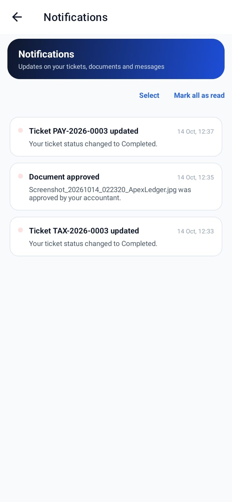
*Figure 7: Notifications*

- The **bell** shows how many you have not read. Your phone also shows an alert when something new arrives (allow notifications when the app asks).
- **Tap a notification** to go straight to the message, document or ticket it is about.
- **Mark all as read** clears the red number.
- **To delete:** tap **Select** (or press and hold one), tick the ones you want, then tap **Delete**.

---

## 3. Accountant guide

### 3.1 Your dashboard

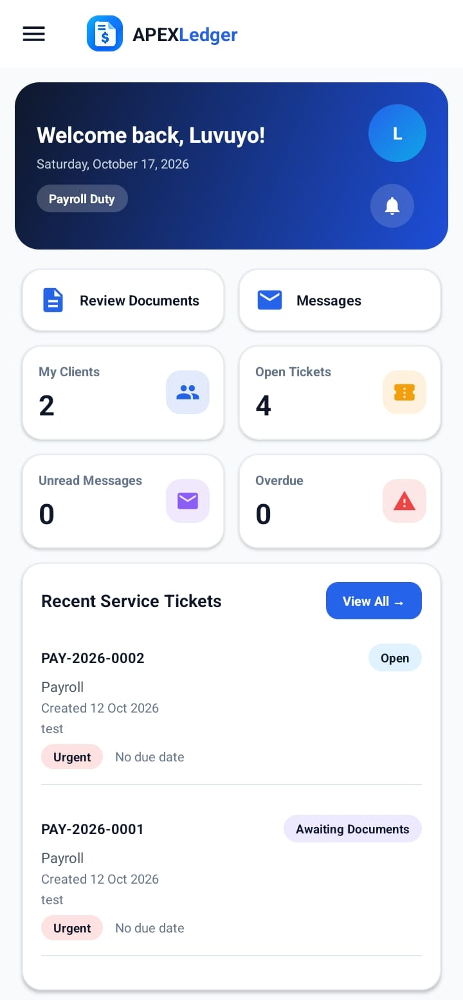
*Figure 8: Staff dashboard*

| Element | Meaning |
|---|---|
| **Welcome banner** | Your name, date and a pill such as **Taxation Duty** |
| **Bell** and **initials** | Notifications and your profile |
| **Due This Week** | Open tickets due within 7 days or already late |
| **Review Documents / Messages** | Quick buttons |
| **Number cards** | My Clients, Open Tickets, Unread Messages, Overdue |
| **Upcoming Public Holidays** | Next holidays in South Africa |
| **Recent Service Tickets** | Newest tickets. **View All →** opens the full list |

The **sidebar** shows Dashboard, Documents, Messages, Service Tickets, My Profile and Logout.

### 3.2 Working on tickets

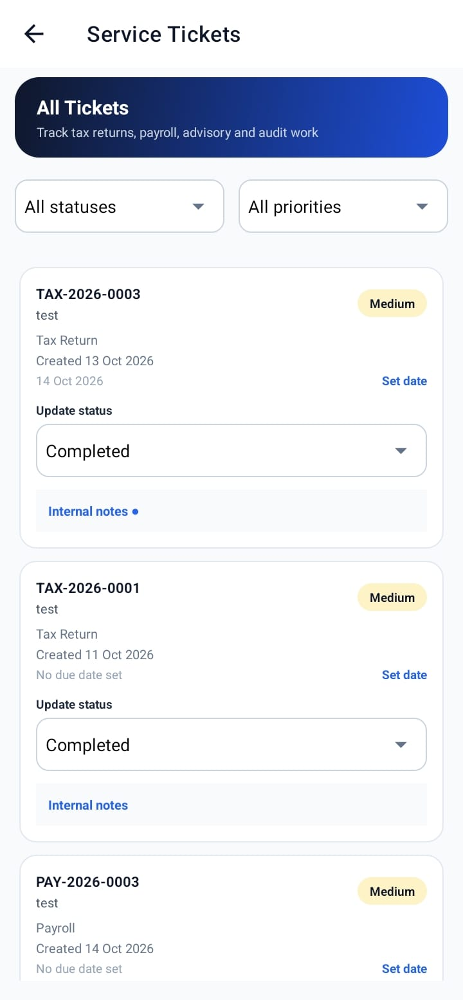
*Figure 9: Staff tickets*

- Each ticket shows the client, service, **Created** date, priority and due date.
- **Status:** use the dropdown on the ticket. The client is notified of every change.
- **Set date:** tap it and pick a due date. The app **checks a public holidays service** and warns you if the date is a **weekend or a South African public holiday**. You can **use the next working day**, **keep your date**, or **cancel**. If the phone is offline, the check is skipped and your date is still saved.
- **Internal notes:** tap to write notes that only staff can see. Clients can never read them.

### 3.3 Reviewing documents

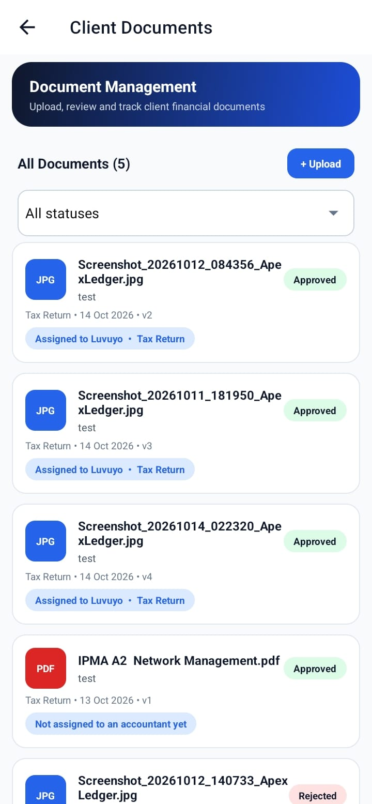
*Figure 10: Document Management*

- You see the documents **routed to your service**. For example, a Payroll accountant sees Payroll documents from any client.
- Use the dropdown to filter by **status**.
- Tap a document to **open** or **download** it.
- Tap **Approve** or **Reject**. The client is notified at once.
- Tap **+ Upload** to upload a document **for a client**: choose the **Client**, the **Category**, tap **Tap to choose a file**, then **Upload Securely**.

### 3.4 Messages

Same as the client screen, plus: new conversations are started with a **client from your list** chosen in the dropdown. You can also reply to any administrator who messages you.

---

## 4. Manager guide

A manager can do everything an accountant can review, except uploading documents. Managers also see **Reports** in the sidebar.

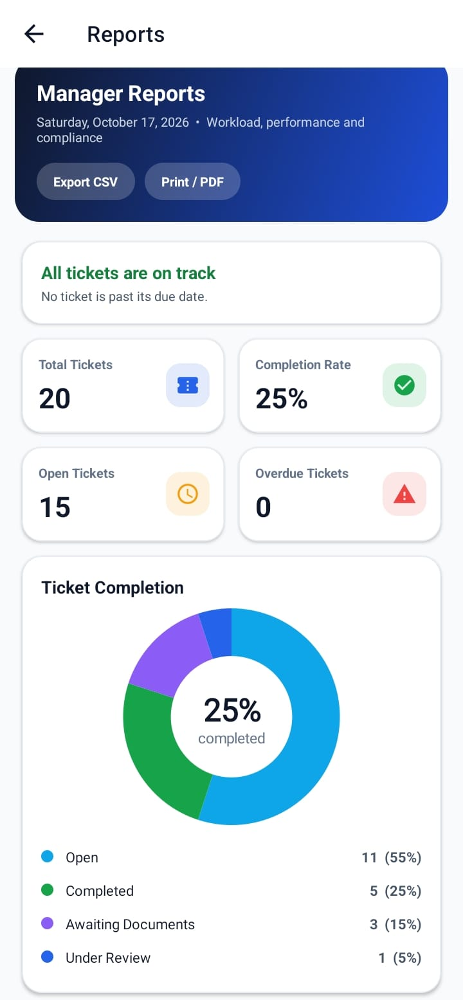
*Figure 11: Reports*

| Element | Meaning |
|---|---|
| **Export CSV / Print / PDF** | Shares the ticket list or a summary |
| **Overdue banner** | Red when tickets are late, green when everything is on track |
| **Number cards** | Total Tickets, Completion Rate, Open Tickets, Overdue Tickets |
| **Ticket Completion** | Donut chart with the completion percentage in the middle |
| **Workload by Accountant** | Open (amber) and completed (green) tickets for each accountant |
| **Security Snapshot** | Failed logins in the last 30 days |

---

## 5. Administrator guide

An administrator has the staff dashboard plus **Reports** and the **Admin Panel**.

### 5.1 User Management

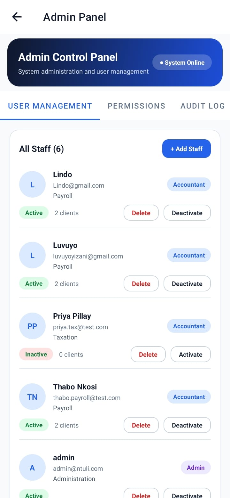
*Figure 12: Admin Panel, User Management tab*

**Adding staff:** tap **+ Add Staff**, fill in the form and tap **Create User**.
- Choosing the role **Admin** sets the department to **Administration** automatically.
- Choosing **Manager** sets **Operations**.
- Choosing **Accountant** lets you pick the **duty**: Taxation, Payroll, Bookkeeping, Advisory or Audit.
- The password needs 8+ characters, 1 uppercase letter and 1 number.

**Adding a client:** tap **+ Add Client** in the **All Clients** box and fill in the form.

**Each staff and client row shows** a name, email, status badge (**Active / Inactive**) and buttons:
- **Deactivate / Activate:** blocks or allows sign-in.
- **Delete:** removes their profile from the app. Their tickets and documents are kept. You cannot delete yourself.

Client rows also show the **tax number** and **Accountant: name • service**.

**Assigning a client:** choose the client and the accountant in **Assign Client to Accountant**, then tap **Assign**. You can also tap **Assign** in **Clients Without an Accountant** on your dashboard.

### 5.2 Permissions, Audit Log and System Health

| Tab | What it shows |
|---|---|
| **PERMISSIONS** | A table of what each role can do (green tick = allowed, red cross = not allowed) |
| **AUDIT LOG** | Every sign-in, upload, review and admin action. Use the search box and the chips **All, Logins, Failed Logins, Tickets, Admin actions**. Failed logins are red |
| **SYSTEM HEALTH** | Storage used, active clients and staff, documents waiting for review, failed logins today, and service status. Tap **Refresh** to update |

### 5.3 Messaging anyone

Under **Messages → Start a Conversation**, the dropdown lists **every client and every staff member** as "Name (Role)". The person is notified and can reply.

---

## 6. Settings for everyone

Open **My Profile** from the sidebar.

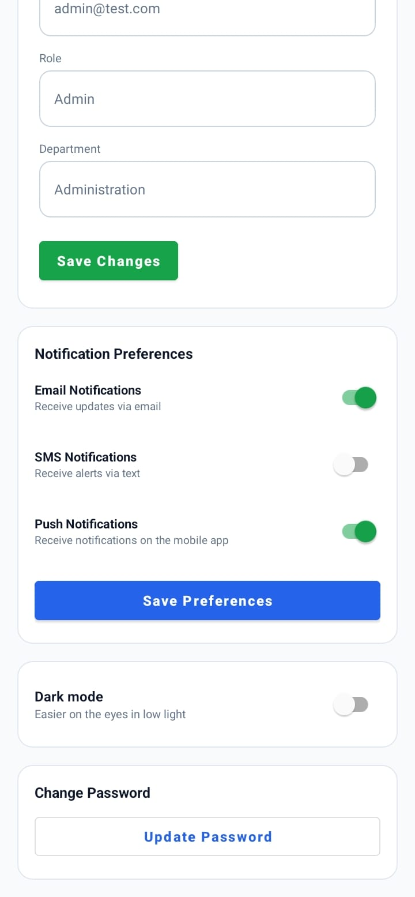
*Figure 13: My Profile*

| Setting | How |
|---|---|
| **Name, phone, address** | Edit them and tap **Save Changes** (green). Email and role cannot be changed. Clients also see their tax number and service |
| **Notification Preferences** | Switch **Email, SMS, Push** on or off, then tap **Save Preferences** |
| **Dark mode** | Switch **Dark mode** on or off. It applies to the whole app and is remembered |
| **Change Password** | Tap **Update Password**, enter your current password, then the new one |

---

## 7. Frequently asked questions

**Why did my document go to a different accountant than usual?**
Documents are sent to the accountant who handles that service. A Payroll document goes to the Payroll accountant even if your own accountant handles Tax.

**Why do I see "Not assigned yet"?**
No accountant has been given to you or to that service yet. An administrator is told and will assign one.

**Can I delete a message for everyone?**
No. Deleting a chat removes it from your list only. The other person keeps their copy.

**Why did the app warn me about a due date?**
The date is a Saturday, a Sunday, or a South African public holiday. You can still keep the date if you want.

**Does the app work offline?**
You can see data already loaded and your changes are sent when you reconnect. Uploads, downloads and new holiday checks need internet.

**How do I log out?**
Open the sidebar and tap **Logout** (red).

---

## 8. Troubleshooting

| Problem | What to do |
|---|---|
| "Too many failed attempts" | Wait 15 minutes, or use **Forgot password?** |
| "This account has been deactivated" | Contact an administrator |
| "This account was removed or is not set up" | Contact an administrator |
| Upload says "Could not read that file" | Pick the file from Downloads or Internal storage; open cloud files once first |
| Upload says "PERMISSION_DENIED" | Tell your administrator. The database rules need updating |
| Google sign-in says "not set up yet" | Tell your administrator. Google sign-in has not been configured |
| No alerts on the phone | Allow notifications for APEXLedger in the phone's settings |
| Screen looks out of date | Pull down to refresh |
| Old app icon after an update | Uninstall and reinstall the app |

---

## 9. Glossary

| Term | Meaning |
|---|---|
| **Ticket** | A service request, for example a tax return, with its own number |
| **Service / duty** | Taxation, Payroll, Bookkeeping, Advisory or Audit |
| **Routing** | Automatically sending your request to the accountant who handles that service |
| **Action Needed** | A task waiting for you on the dashboard |
| **Audit log** | A permanent record of important actions in the app |
| **Deactivate** | Block someone from signing in without deleting them |
| **SSO** | Single sign-on: signing in with your Google account |
