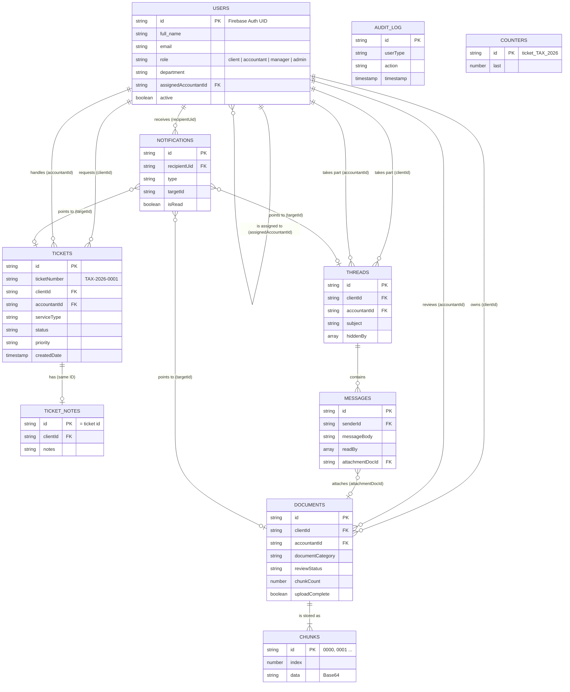

# APEXLedger Database Design

This document describes the database behind the APEXLedger Android app: its structure, every table (collection) and field, how the tables relate, and the rules that protect the data.

## 1. Overview

| | |
|---|---|
| **DBMS** | Google **Cloud Firestore** (managed document database, part of Firebase) |
| **Login data** | Firebase Authentication stores emails and password hashes. The app never stores passwords. |
| **Tables** | 9: `users`, `tickets`, `ticket_notes`, `documents`, `documents/chunks`, `threads`, `threads/messages`, `notifications`, `audit_log`, `counters` (counted as `chunks` and `messages` being sub-tables) |
| **Security** | Server-side rules in [`firestore.rules`](../firestore.rules) |

### Why Firestore, and how it maps to a relational design

Firestore stores **documents** inside **collections**. It is the same design as relational tables, with different words:

| Relational term | In this project |
|---|---|
| Table | Collection (for example `tickets`) |
| Row | Document |
| Primary key | The **document ID** (unique inside its collection) |
| Foreign key | A field that holds another document's ID (for example `tickets.clientId` holds a `users` ID) |
| Child table | **Sub-collection** (for example `documents/{id}/chunks`) |
| Column data type | Firestore field type (string, number, boolean, timestamp, array) |

Firestore does not enforce foreign keys in the database. The app and the security rules enforce them. Each collection has a single clear purpose, and data is **not duplicated**, except for two deliberate copies explained in section 6.

## 2. Entity relationship diagram

> `AUDIT_LOG` and `COUNTERS` stand alone: the audit log is a record of events, and counters only supply the next ticket number.

### Relationship summary

| Parent | Child | Link field | Type |
|---|---|---|---|
| users (client) | tickets | `tickets.clientId` | one to many |
| users (accountant) | tickets | `tickets.accountantId` | one to many |
| users (client) | documents | `documents.clientId` | one to many |
| users (accountant) | documents | `documents.accountantId` | one to many |
| documents | chunks | sub-collection | one to many (at least 1) |
| users | threads | `threads.clientId`, `threads.accountantId` | one to many |
| threads | messages | sub-collection | one to many |
| tickets | ticket_notes | same document ID | one to zero or one |
| users | notifications | `notifications.recipientUid` | one to many |
| users (accountant) | users (client) | `users.assignedAccountantId` | one to many |
| messages | documents | `messages.attachmentDocId` | many to zero or one |

## 3. Data dictionary

**Key:** PK = primary key, FK = foreign key. **Req** = always present (Y) or only sometimes (n).

### 3.1 `users`

One document per person. **PK:** the Firebase Auth user ID.

| Field | Type | Key | Req | Description / allowed values |
|---|---|---|---|---|
| (document ID) | string | PK | Y | Firebase Authentication UID |
| `full_name` | string | | Y | Display name |
| `email` | string | | Y | Login email, valid format |
| `role` | string | | Y | `client`, `accountant`, `manager`, `admin` |
| `active` | boolean | | Y | `false` blocks sign-in |
| `department` | string | | n | Staff only: `Taxation (accountant)`, `Payroll (accountant)`, `Bookkeeping (accountant)`, `Advisory (accountant)`, `Audit (accountant)`, `Administration` (admin) or `Operations` (manager) |
| `phone` | string | | n | Clients |
| `address` | string | | n | Clients |
| `taxNumber` | string | | n | Clients: exactly 10 digits |
| `servicePreference` | string | | n | `tax_return`, `payroll`, `bookkeeping`, `advisory`, `audit` |
| `assignedAccountantId` | string | FK → users | n | The client's own accountant. Empty if unassigned |
| `notify_email`, `notify_sms`, `notify_push` | boolean | | n | Notification settings |
| `created_at` | timestamp | | Y | Account creation time |

### 3.2 `tickets`

A service request. **PK:** auto-generated document ID. The readable key `ticketNumber` is unique.

| Field | Type | Key | Req | Description / allowed values |
|---|---|---|---|---|
| (document ID) | string | PK | Y | |
| `ticketNumber` | string | unique | Y | `PREFIX-YEAR-0001`; prefixes TAX, PAY, BKP, ADV, AUD |
| `clientId` | string | FK → users | Y | Who asked |
| `accountantId` | string | FK → users | n | Accountant for this service |
| `accountantName` | string | | n | Copy of the accountant's name (see section 6) |
| `serviceType` | string | | Y | `tax_return`, `payroll`, `bookkeeping`, `advisory`, `audit` |
| `priority` | string | | Y | `low`, `medium`, `high`, `urgent` |
| `status` | string | | Y | `open`, `in_progress`, `awaiting_documents`, `under_review`, `completed`, `cancelled` |
| `description` | string | | Y | Free text from the client |
| `dueDate` | string | | n | `yyyy-MM-dd`, empty until set |
| `createdDate` | timestamp | | Y | When it was created |
| `statusChangedAt` | timestamp | | n | When the status last changed |

### 3.3 `ticket_notes`

Internal notes for staff. **PK:** the **same ID as the ticket** (one note per ticket). Clients can never read this collection.

| Field | Type | Key | Description |
|---|---|---|---|
| (document ID) | string | PK, FK → tickets | |
| `clientId` | string | FK → users | The ticket's client |
| `notes` | string | | Note text |

### 3.4 `documents`

File metadata. The file contents are in the `chunks` sub-collection. **PK:** auto-generated ID.

| Field | Type | Key | Req | Description / allowed values |
|---|---|---|---|---|
| (document ID) | string | PK | Y | |
| `clientId` | string | FK → users | Y | Whose document it is |
| `accountantId`, `accountantName` | string | FK → users | n | Accountant handling this category |
| `uploadedBy` | string | FK → users | n | Who uploaded it (client or staff) |
| `source` | string | | n | `staff` or `message` for non-client uploads |
| `fileName` | string | | Y | Original file name |
| `mimeType` | string | | Y | `application/pdf`, `image/jpeg`, `image/png` |
| `documentCategory` | string | | Y | Same values as `serviceType`, plus `other` |
| `fileSizeBytes` | number | | Y | Maximum 10 MB |
| `storageType` | string | | Y | `firestore` |
| `filePath` | string | | n | Empty for new files; web link for old documents |
| `chunkCount` | number | | Y | Number of 512 KB pieces |
| `reviewStatus` | string | | Y | `pending`, `under_review`, `approved`, `rejected` |
| `version` | number | | Y | Starts at 1 |
| `previousVersionIds` | array of string | FK → documents | Y | Earlier versions of the same file |
| `uploadComplete` | boolean | | Y | `true` only after every chunk is saved |
| `uploadTimestamp` | timestamp | | Y | |

### 3.5 `documents/{documentId}/chunks`

The file itself, cut into pieces. **PK:** a 4-digit sequence (`0000`, `0001`, ...).

| Field | Type | Key | Description |
|---|---|---|---|
| (document ID) | string | PK | Position of the piece |
| `index` | number | | Same as the ID, as a number |
| `data` | string | | The piece, Base64 encoded |

### 3.6 `threads`

A conversation. **PK:** auto-generated ID.

| Field | Type | Key | Req | Description |
|---|---|---|---|---|
| (document ID) | string | PK | Y | |
| `clientId` | string | FK → users | Y | The client. When an administrator starts a chat with a staff member, this holds that staff member's ID |
| `accountantId`, `accountantName` | string | FK → users | n | The other person in the chat |
| `subject` | string | | Y | |
| `serviceType` | string | | n | Service the chat is about |
| `lastMessagePreview` | string | | Y | Shown in the list |
| `isUrgent` | boolean | | Y | Set automatically by words such as *urgent* |
| `hiddenBy` | array of string | FK → users | n | People who deleted the chat from their list |
| `createdDate` | timestamp | | Y | |

### 3.7 `threads/{threadId}/messages`

| Field | Type | Key | Req | Description |
|---|---|---|---|---|
| (document ID) | string | PK | Y | |
| `senderId` | string | FK → users | Y | Must equal the signed-in user (enforced by rules) |
| `messageBody` | string | | Y | |
| `isUrgent` | boolean | | Y | |
| `readBy` | array of string | FK → users | Y | Who has read it |
| `sentTimestamp` | timestamp | | Y | |
| `attachmentDocId` | string | FK → documents | n | Attached file |
| `attachmentName` | string | | n | |

### 3.8 `notifications`

| Field | Type | Key | Req | Description |
|---|---|---|---|---|
| (document ID) | string | PK | Y | |
| `recipientUid` | string | FK → users | Y | Who sees it |
| `type` | string | | Y | For example `new_message`, `document_upload`, `document_review`, `ticket_update` |
| `title`, `body` | string | | Y | Text shown |
| `targetId` | string | FK → threads / documents / tickets | n | Where a tap opens |
| `isRead` | boolean | | Y | |
| `createdAt` | timestamp | | Y | |

### 3.9 `audit_log`

An append-only record of important actions. **PK:** auto-generated ID.

| Field | Type | Req | Description |
|---|---|---|---|
| (document ID) | string (PK) | Y | |
| `userType` | string | Y | `Client`, `User`, `Admin` |
| `action` | string | Y | For example `Login`, `Failed Login`, `Upload Document`, `Document Review`, `Create Staff Account` |
| `details` | string | n | Extra text |
| `timestamp` | timestamp | Y | |

### 3.10 `counters`

Supplies the next ticket number. **PK:** `ticket_{PREFIX}_{YEAR}`, for example `ticket_TAX_2026`.

| Field | Type | Description |
|---|---|---|
| (document ID) | string (PK) | One counter per service and year |
| `last` | number | The last number used. A transaction adds 1 each time, so numbers never repeat |

## 4. Naming conventions

| Item | Convention | Example |
|---|---|---|
| Collection | lowercase, plural (snake_case when two words) | `tickets`, `ticket_notes`, `audit_log` |
| Field | camelCase | `serviceType`, `clientId`, `uploadTimestamp` |
| Foreign key | the related thing + `Id` (or `Uid` for notifications) | `clientId`, `accountantId`, `recipientUid` |
| Boolean | starts with `is`, or is a plain state word | `isRead`, `isUrgent`, `active` |
| Timestamp | ends in `Date`, `Timestamp` or `At` | `createdDate`, `sentTimestamp`, `createdAt` |
| Fixed values | lowercase with underscores | `in_progress`, `tax_return` |

**Known exceptions:** six fields in `users` come from the first version of the app and use snake_case: `full_name`, `created_at`, `notify_email`, `notify_sms`, `notify_push`. They are kept so existing accounts keep working. A future version could rename them with a one-off migration.

## 5. How the data is used (queries)

| Screen | Query |
|---|---|
| Client tickets | `tickets` where `clientId` = my ID |
| Accountant tickets | `tickets` where `accountantId` = my ID, plus tickets of my assigned clients that have no accountant yet |
| Documents (client) | `documents` where `clientId` = my ID and `uploadComplete` is not `false`, newest versions only |
| Notifications and bell | `notifications` where `recipientUid` = my ID and `isRead` = `false` (live listener) |
| Conversations | `threads` where `clientId` = my ID, hiding those whose `hiddenBy` contains my ID |
| Ticket number | Transaction on `counters/ticket_{PREFIX}_{YEAR}` |

All of these are single-field queries or equality filters, so Firestore needs **no composite indexes**.

## 6. Design decisions

- **Documents are cut into chunks** because a Firestore document is limited to 1 MB. A file is saved as 512 KB pieces, and it only becomes visible when `uploadComplete = true`. This keeps files inside the free plan, with no separate storage service.
- **Deliberate copies:** `accountantName` is stored next to `accountantId` in `tickets`, `documents` and `threads`, and `lastMessagePreview` is stored in `threads`. This avoids extra reads on every list screen. The ID is always the source of truth.
- **One chat per pair of people:** a conversation is stored once. A user "deleting" it only adds their ID to `hiddenBy`, so the other person keeps their copy.
- **Roles live in `users.role`** and are enforced by the security rules, not just hidden in the interface.
- **Soft removal:** accounts are **deactivated** (`active = false`) rather than erased, so past tickets, documents and audit records stay meaningful. A delete removes only the profile.
- **Routing by service:** the accountant for a ticket, document or chat is chosen from `users.department`, so one accountant owns one service.

## 7. Security and integrity

The rules in [`firestore.rules`](../firestore.rules) apply the following on the server:

| Collection | Who can do what |
|---|---|
| `users` | Read: yourself, staff, or any accountant's profile. Update: yourself (not role, department, accountant, tax number or active) or an admin. Create staff and delete: admin only |
| `tickets` | Read: the client and staff. Update: staff may change anything; a client may only edit the description |
| `ticket_notes` | Staff only |
| `documents` and `chunks` | Read: owner and staff. Create: owner, or an admin or accountant uploading for a client. Update: staff, or the owner marking `uploadComplete` |
| `threads` and `messages` | Read and write: the client in the chat and staff. A message's `senderId` must be the signed-in user |
| `notifications` | Read, update and delete: only the recipient |
| `audit_log` | Read: staff. Create: any signed-in user, and failed logins without sign-in |
| `counters` | Signed-in users may create or add exactly 1 to the counter |

**Data validation in the app** (before saving): email format, password of 8+ characters with an uppercase letter and a number, tax number of 10 digits, file type PDF/JPG/PNG up to 10 MB.
